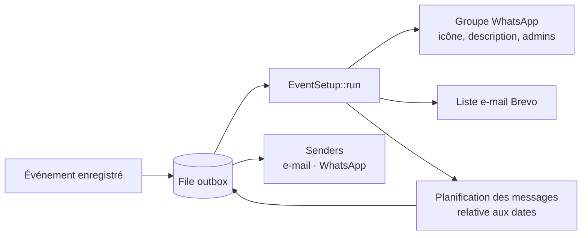

# Neuraframe — automatisation des événements

Extrait du code de production de [Neuraframe](https://neuraframe.ch), une plateforme SaaS
multi-tenant (PHP 8, MySQL) qui automatise les inscriptions, les e-mails et les groupes
WhatsApp de formateurs et d'organisateurs d'événements.

## Le problème

Préparer un événement prenait jusqu'à **3 jours de travail manuel** : créer le groupe
WhatsApp, son icône, sa description, nommer les administrateurs, créer la liste d'e-mails,
puis programmer à la main chaque rappel (J-7, J-1, jour J…) selon les dates de l'événement.

## La solution

Quand un événement est enregistré, un job `event.setup` est mis en file d'attente.
Le worker appelle `EventSetup::run()`, qui fait tout en **quelques secondes** :

## Ce que montre ce dépôt

| Fichier | Rôle |
|---|---|
| [`src/EventSetup.php`](src/EventSetup.php) | Orchestrateur : verrou MySQL `GET_LOCK` contre les exécutions en double (bouton + cron), étapes idempotentes (on ne recrée pas un groupe ou une liste qui existe), état de progression écrit en base pour l'interface, planification des automatisations à partir du graphe dessiné par l'utilisateur. |
| [`src/Outbox.php`](src/Outbox.php) | File de messages asynchrone : verrouillage `FOR UPDATE` contre les doubles traitements, clé d'idempotence, reprise avec backoff exponentiel, puis file des échecs (DLQ). |
| [`src/senders/WppSender.php`](src/senders/WppSender.php) | Envoi WhatsApp via Evolution API, avec repli sur le numéro de la plateforme si le tenant n'a pas connecté le sien. |
| [`src/Sandbox.php`](src/Sandbox.php) | Mode « bac à sable » pour les comptes de démonstration : aucun e-mail ni message ne sort, mais l'interface se comporte normalement. |

## Sécurité

- Isolation multi-tenant : chaque requête filtre par `tenant_id`.
- Secrets des intégrations (Stripe, Postal) chiffrés en base (AES-256-GCM) et **jamais
  renvoyés en clair au navigateur**, même à un administrateur : uniquement une forme masquée.
- Comptes de démonstration isolés par le bac à sable, placé *avant* le repli WhatsApp —
  sinon un test aurait écrit depuis le vrai numéro de la plateforme.

## À savoir

- C'est un **extrait** : il dépend d'autres briques de la plateforme (connexion aux bases,
  création des groupes, listes Brevo) qui restent privées. Il n'est pas exécutable seul.
- Le code a été écrit avec l'aide d'assistants IA (Claude, Codex). La conception, les choix
  d'architecture, l'intégration, les tests et l'exploitation en production sont les miens.

## Auteur

Kevin Nogueira — Suisse · [LinkedIn](https://www.linkedin.com/in/kevin-nogueira)
